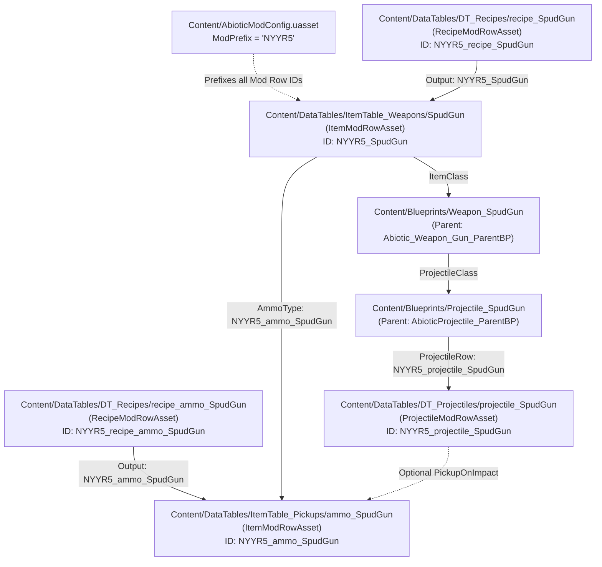

# Abiotic Factor Modding Context & Reference (`SpudGunLsjct` / SpudGun)

This project is an **Abiotic Factor** mod (`SpudGun`) generated from the official **"Projectile Ranged Weapon"** mod template.
Both **Antigravity** (via `AGENTS.md`) and **Claude Code** (via `CLAUDE.md`) use this file as the shared source of truth for project structure, engine conventions, and binary `.uasset` internals.

---

## 1. Engine & Mod Architecture

- **Game**: Abiotic Factor (by Deep Field Games)
- **Engine Version**: Unreal Engine `5.4.4-1050002+++DF+ABF` (Custom UE 5.4.4 build)
- **Mod Type**: Content-only Unreal Engine Plugin (`"Category": "UGC"`, `"CanContainContent": true`, `"NoCode": true`, `"ExplicitlyLoaded": true`)
- **Plugin Mount Point**: `/SpudGunLsjct/` (matches the `.uplugin` and folder name)
- **Mod Prefix**: **`NYYR5`** (defined in `Content/AbioticModConfig.uasset`)
- **Template**: **"Projectile Ranged Weapon"** (`LocalizedDescriptions`: *"This template features a projectile ranged weapon item, including the ammo item, projectile, and recipes for the weapon and ammo"*)
- **Packaging**: Uses Mod.io UGC (`Content/UUGC_Metadata.uasset`, native class `/Script/ModioUGC.UGC_Metadata`) with `EPrimaryAssetCookRule::AlwaysCook`.

### Important Note on `.uasset` Files
Unreal Engine `.uasset` files are binary serialized packages.
- **Do not** edit `.uasset` files as plain text.
- You **can** inspect strings, property names, class hierarchies, and row references inside `.uasset` files from PowerShell or Python (e.g., extracting ASCII/UTF-16 strings or parsing the UE5 package name table) to debug references without opening the Unreal Editor.

---

## 2. Directory & File Structure

```text
SpudGun/                                  # Git Repository Root
├── AGENTS.md                             # Antigravity project reference (this file)
├── CLAUDE.md                             # Claude Code entry point
├── .gitignore                            # Git ignore rules for UE5 and temp files
│
└── SpudGunLsjct/                         # Mod Plugin Mount (/SpudGunLsjct/) - Uploaded to Mod.io
    ├── SpudGunLsjct.abfmod               # Mod.io marker file with ModId
    ├── SpudGunLsjct.uplugin              # UE5 plugin descriptor ("SpudGun")
    ├── TemplateDefs.ini                  # Template metadata ("Projectile Ranged Weapon")
    ├── Config/
    │   └── Tags/                         # Gameplay tag configurations
    ├── Media/
    │   ├── SpudGunLsjct.png              # Mod icon
    │   └── SpudGunLsjct_Preview.png      # Mod preview image
    └── Content/
        ├── AbioticModConfig.uasset       # ModPrefix ("NYYR5")
        ├── UUGC_Metadata.uasset          # Mod.io UGC cook rules
        ├── Blueprints/
        │   ├── Weapon_SpudGun.uasset     # Ranged weapon Actor Blueprint
        │   └── Projectile_SpudGun.uasset # Physical projectile Actor Blueprint
        └── DataTables/
            ├── DT_Projectiles/
            │   └── projectile_SpudGun.uasset   # Projectile physics & damage row
            ├── DT_Recipes/
            │   ├── recipe_SpudGun.uasset       # Weapon crafting recipe row
            │   └── recipe_ammo_SpudGun.uasset  # Ammo crafting recipe row
            ├── ItemTable_Pickups/
            │   └── ammo_SpudGun.uasset         # Ammo item data row
            └── ItemTable_Weapons/
                └── SpudGun.uasset              # Weapon item data row
```

---

## 3. Core Abiotic Factor Modding Concepts

### A. Mod Prefix (`AbioticModConfig.uasset`)
- **Native Class**: `/Script/AbioticFactor.AbioticModConfiguration`
- **Property**: `ModPrefix` (`NameProperty`) = **`NYYR5`**
- **How It Works**: Abiotic Factor uses `ModPrefix` to namespace custom DataTable rows so multiple mods don't collide. When one asset references a custom mod row handle, the row name is formatted as **`<ModPrefix>_<AssetName>`**:
  - Weapon Item Handle: **`NYYR5_SpudGun`**
  - Ammo Item Handle: **`NYYR5_ammo_SpudGun`**
  - Projectile Handle: **`NYYR5_projectile_SpudGun`**
  - Weapon Recipe Handle: **`NYYR5_recipe_SpudGun`**
  - Ammo Recipe Handle: **`NYYR5_recipe_ammo_SpudGun`**

### B. DataTable "Mod Row Assets" (`Content/DataTables/`)
Instead of overwriting base-game DataTables (which breaks mod compatibility), Abiotic Factor uses individual **Mod Row Assets** (`UAbioticModRowAsset` subclasses) placed in subdirectories named after the target DataTable:

| Subfolder | Base Game DataTable | Asset File | Native Class (`/Script/AbioticFactor.*`) | Row Handle ID |
| :--- | :--- | :--- | :--- | :--- |
| `ItemTable_Weapons/` | `/Game/Blueprints/DataTables/Items/ItemTable_Weapons` | `SpudGun.uasset` | `ItemModRowAsset` | `NYYR5_SpudGun` |
| `ItemTable_Pickups/` | `/Game/Blueprints/DataTables/Items/ItemTable_Pickups` | `ammo_SpudGun.uasset` | `ItemModRowAsset` | `NYYR5_ammo_SpudGun` |
| `DT_Projectiles/` | `/Game/Blueprints/DataTables/Items/DT_Projectiles` | `projectile_SpudGun.uasset` | `ProjectileModRowAsset` | `NYYR5_projectile_SpudGun` |
| `DT_Recipes/` | `/Game/Blueprints/DataTables/Crafting/DT_Recipes` | `recipe_SpudGun.uasset` | `RecipeModRowAsset` | `NYYR5_recipe_SpudGun` |
| `DT_Recipes/` | `/Game/Blueprints/DataTables/Crafting/DT_Recipes` | `recipe_ammo_SpudGun.uasset` | `RecipeModRowAsset` | `NYYR5_recipe_ammo_SpudGun` |

#### Adding a New Row vs. Overriding a Base-Game Row (`bOverrideExistingRow`)
Every `UAbioticModRowAsset` is registered at runtime by `UABFRowRegistrySubsystem` and supports two modes:
1. **New Prefixed Row (Default, `bOverrideExistingRow = false`)**:
   - Registers a brand-new row prefixed with `<ModPrefix>_<RowName>` (e.g., `NYYR5_SpudGun`).
   - In the Editor, you can populate it using the **"Copy From Row"** button to clone any base-game item/weapon/projectile values.
2. **Override Base-Game Row (`bOverrideExistingRow = true`)**:
   - In the Editor Details panel of any Mod Row Asset, ticking **"Override Existing Row"** (`bOverrideExistingRow`) allows targeting an existing base-game row name directly (for example, `crossbow` in `ItemTable_Weapons`) without the `ModPrefix`.
   - This modifies base-game items, stats, or recipes in-place.

### C. Local SDK, Logs & Binary Inspection Paths
- **Mod Editor Binary**: `C:\Program Files\Epic Games\AbioticFactorModEditkx2ug\AbioticFactor\Binaries\Win64\AbioticFactorEditorCooked-Win64-Test.exe`
- **Cooked Base-Game Paks**: `C:\Program Files\Epic Games\AbioticFactorModEditkx2ug\AbioticFactor\Content\Paks\AbioticFactor-WindowsCookedEditor.{pak,utoc,ucas,o.utoc,o.ucas}`
- **Development Asset Registry (36 MB)**: `C:\Program Files\Epic Games\AbioticFactorModEditkx2ug\AbioticFactor\Releases\UGCRelease\Windows\Metadata\DevelopmentAssetRegistry.bin`
- **Mod Templates Directory**: `C:\Program Files\Epic Games\AbioticFactorModEditkx2ug\ModTemplates\` (contains 35 official templates including `TP_ProjectileRangedWeapon`)
- **Live Editor / PIE Log**: `C:\Users\vczle\AppData\Local\AbioticFactor\Saved\Logs\AbioticFactor.log`
- **Performance Tip for LLM Agents**:
  - Do **not** run `re.finditer` over the entire 1.7 GB `.pak` or 6.5 GB `.ucas` file.
  - Instead, search `DevelopmentAssetRegistry.bin` (36 MB) or `AbioticFactor-WindowsCookedEditor.o.ucas` (663 MB editor-only Blueprint/class metadata) using Python `bytes.find(b'...')` (<0.2s), and only run regex extraction on small 10–50 KB slices around matched offsets.

---

## 4. Detailed Breakdown of Ranged Weapon Template Assets

### 1. Weapon Item Data Row (`Content/DataTables/ItemTable_Weapons/SpudGun.uasset`)
- **Native Class**: `/Script/AbioticFactor.ItemModRowAsset` (wraps `AbioticItem_Struct`)
- **Row ID**: `NYYR5_SpudGun`
- **Key Properties**:
  - `ItemClass`: `/SpudGunLsjct/Blueprints/Weapon_SpudGun.Weapon_SpudGun_C` (SoftClassProperty)
  - `ItemName` (`FText`): In-game display name (e.g., *"Spud Gun"*)
  - `ItemDescription` (`FText`): Flavor text and stats tooltip
  - `Icon` (Texture2D): Inventory icon
  - `Weight` (`FloatProperty`): Item carry weight
  - `ItemType`: `E_ItemType::Weapon`
  - `EquipSlot`: `E_EquipSlot::Hands`
  - `WeaponData` (`AbioticWeaponData_Struct`):
    - `AmmoType` (`GlobalItemRowHandle`): **`NYYR5_ammo_SpudGun`** (links required ammunition)
    - `MaxDurability` (`FloatProperty`): Weapon durability pool
    - `DurabilityLossPerShot` (`FloatProperty`)
    - `MagazineSize` (`IntProperty`): Loaded rounds before reloading (e.g., 1 for single-shot, or multiple for hopper)
    - `FireRate` (`FloatProperty`)
    - `ReloadSpeed` (`FloatProperty`)

### 2. Weapon Actor Blueprint (`Content/Blueprints/Weapon_SpudGun.uasset`)
- **Inheritance Chain**:
  - `/Script/Engine.Actor` (Native C++)
  - $\rightarrow$ `/Game/Blueprints/Items/Abiotic_Item_ParentBP`
  - $\rightarrow$ `/Game/Blueprints/Items/Weapons/Abiotic_Weapon_Gun_ParentBP`
  - $\rightarrow$ `Weapon_SpudGun_C`
- **Key Properties & Components**:
  - `ItemMesh` (`SkeletalMeshComponent` or `StaticMeshComponent`): Visual weapon model held in hands.
  - `ProjectileClass`: Pointed to `/SpudGunLsjct/Blueprints/Projectile_SpudGun.Projectile_SpudGun_C`.
  - `MuzzleLocation` (`SceneComponent` / Socket): Defines spawn transform for launched projectile.
  - `FireSound`: `/Game/Audio/Guns/Crossbow/crossbow_fire_01_Cue` (or custom sound cue).
  - `EquipAnimation` / `FireAnimation`: `/Game/Animations/Weapons/Anim_Weapon_CrossBow_Loaded`.

### 3. Projectile Actor Blueprint (`Content/Blueprints/Projectile_SpudGun.uasset`)
- **Inheritance Chain**:
  - `/Script/Engine.Actor` (Native C++)
  - $\rightarrow$ `/Game/Blueprints/Projectiles/AbioticProjectile_ParentBP`
  - $\rightarrow$ `Projectile_SpudGun_C`
- **Key Properties & Components**:
  - `ProjectileMovement` (`UProjectileMovementComponent`): Handles initial speed, gravity, trajectory, and bounce simulation.
  - `CollisionComponent` (`USphereComponent` / `UCapsuleComponent`): Detects hit events against enemies, world geometry, and actors.
  - `ProjectileRow` (`ProjectileRowHandle`): Pointed to **`NYYR5_projectile_SpudGun`**.
  - `OnProjectileHit`: Triggers damage delivery, sound effects, particle impacts, and item retrieval if the potato/projectile can be picked back up.

### 4. Projectile Data Row (`Content/DataTables/DT_Projectiles/projectile_SpudGun.uasset`)
- **Native Class**: `/Script/AbioticFactor.ProjectileModRowAsset` (wraps `AbioticProjectile_Struct`)
- **Row ID**: `NYYR5_projectile_SpudGun`
- **Key Properties**:
  - `InitialSpeed` / `MaxSpeed` (`FloatProperty`): Velocity of the projectile.
  - `GravityScale` (`FloatProperty`): Downward arc / drop over distance.
  - `BaseDamage` (`FloatProperty`): Damage value applied to hit targets.
  - `DamageType`: `/Game/Blueprints/DamageTypes/DamageType_Sharp_Crossbow` (or blunt/impact damage).
  - `ImpactMesh`: `/Game/Models/Items/Ammo/SM_CraftedBolt01` (visual mesh).
  - `PickupItemOnImpact` (`GlobalItemRowHandle`): If recoverable, references `NYYR5_ammo_SpudGun` or `food_potato`.

### 5. Ammo Item Data Row (`Content/DataTables/ItemTable_Pickups/ammo_SpudGun.uasset`)
- **Native Class**: `/Script/AbioticFactor.ItemModRowAsset` (wraps `AbioticItem_Struct`)
- **Row ID**: `NYYR5_ammo_SpudGun`
- **Key Properties**:
  - `ItemName`: e.g., *"Potato Ammo"* or *"Spud Pellet"*
  - `MaxStackSize` (`IntProperty`): e.g., 20 or 50 rounds per inventory slot.
  - `ItemType`: `E_ItemType::Ammo`
  - `StashAudio`: `/Game/Audio/UI/Inventory/item_stash_metal_Cue`

### 6. Crafting Recipe Rows (`Content/DataTables/DT_Recipes/`)
- **Weapon Recipe (`recipe_SpudGun.uasset`)**:
  - Row ID: `NYYR5_recipe_SpudGun`
  - `OutputItem`: `NYYR5_SpudGun` (Count: 1)
  - `Ingredients` (Array of `AbioticItemCount`): Materials required to craft (e.g., pipes, springs, duct tape).
  - `RequiredBench`: `CraftingBench` or `None` (hand craftable).
  - `RequiredSkillLevel` / `WorldFlag`: Progression gate.
- **Ammo Recipe (`recipe_ammo_SpudGun.uasset`)**:
  - Row ID: `NYYR5_recipe_ammo_SpudGun`
  - `OutputItem`: `NYYR5_ammo_SpudGun` (Count: e.g., 5)
  - `Ingredients`: Potatoes, fertilizer, foil, etc.

---

## 5. How Ranged Weapon Assets Link Together



---

## 6. Play-In-Editor (PIE) Testing & Developer Cheat Menu

While playing in PIE, pressing **`\` (Backslash)** opens Abiotic Factor's built-in **Game Command Menu** (`/Game/Blueprints/Widgets/GameCommand/W_GameCommandMenu`, hosted inside `/Game/Blueprints/Developer/W_CheatMenu`):

| Game Command | Parameter / Example | Purpose |
| :--- | :--- | :--- |
| **`SpawnItem`** | `NYYR5_SpudGun` | Spawns the weapon directly into the player's primary inventory. |
| **`SpawnItem`** | `NYYR5_ammo_SpudGun` | Spawns ammunition directly into player inventory. |
| **`SpawnItemOnGround`** | `NYYR5_SpudGun` | Tests physics drop and pickup collision on the floor. |
| **`UnlockAllRecipes`** | — | Unlocks all crafting bench recipes including custom mod recipes. |
| **`TriggerEveryWorldFlag`** | — | Unlocks all world flags to test progression-gated weapons and recipes. |
| **`LevelFX_SpawnGlobalActors`** | — | Spawns global world actors (`Abiotic_AIDirector`, `DayNightManager`) on empty test maps. |

---

## 7. Package Binary Serialization Gotchas (UE5 `LinkerLoad` & `ScriptSerializationEndOffset`)

When programmatically modifying or appending serialized properties to `.uasset` binary packages (such as cloning ingredients or modifying projectile stats in Python):

### A. The LinkerLoad Deserialization Assertion
During cloud cooking or strict headless verification (`AbioticFactorEditorCookedCooker-Cmd.exe`), the engine enforces an exact byte check in `LinkerLoad.cpp:6331`:
```text
LogWindows: Error: Assertion failed: Export.ScriptSerializationEndOffset == (Tell() - Export.SerialOffset) 
[File:Engine\Source\Runtime\CoreUObject\Private\UObject\LinkerLoad.cpp] [Line: 6331] 
Serialized script property end offset does not match offset during deserialization
```

### B. `FObjectExport` Layout in UE 5.4.4 (112 Bytes per Export)
Every export entry in the package Export Table contains:
* `+28` (`int64`): `SerialSize` — Total byte size of the serialized export payload.
* `+36` (`int64`): `SerialOffset` — Absolute stream offset where the export begins.
* `+96` (`int64`): `ScriptSerializationStartOffset` — Relative offset where script properties start (usually `0`).
* `+104` (`int64`): **`ScriptSerializationEndOffset`** — Relative stream position where script property serialization terminates (before the final 4-byte `PACKAGE_FILE_TAG` `0x9E2A83C1`).

> [!CRITICAL]
> Whenever bytes are added or removed from an export payload, `ScriptSerializationEndOffset` (+104) must be kept exactly synchronized to `SerialSize - 4`. Failing to update offset +104 causes headless cookers and cloud builders to abort with exit code 3.

---

## 8. Packaging, Local Testing & Mod.io Publishing Pipeline

### A. Why Local `Package UGC` & `RunUAT.bat` Fail
The standalone Abiotic Factor Mod Editor (`AbioticFactorEditorCooked-Win64-Test.exe`) is distributed without the Unreal Automation Tool (`Engine/Build/BatchFiles/RunUAT.bat` or `AutomationTool.dll`).
* Clicking generic Unreal Engine toolbar options such as **"Package UGC"**, **"Platforms -> Package Project"**, or **"Project Launcher"** will fail with:
  `A required file could not be found: .../Engine/Build/BatchFiles/RunUAT.bat` or `SDK Not Setup`.
* This is intentional: Deep Field Games designed mod packaging to run through the official **Mod.io Cloud Cooking** pipeline rather than local UAT compilation.

### B. The Official In-Editor Publishing Tool ("Upload Mod")
To package and publish your mod:
1. In the Mod Editor toolbar, click the **Mod.io / "Upload Mod"** button.
2. Select **"Add New Mod Listing"** (or choose your existing listing).
3. Under **Mod Root Directory (`ModRootDir`)**, select the clean plugin directory:
   `C:\Users\vczle\Documents\Abiotic Factor Mods\SpudGun\SpudGunLsjct`
   *(Important: Do NOT select the parent `SpudGun/` folder! Selecting `SpudGunLsjct/` ensures only the necessary `.uplugin`, `Content/`, and `Media/` files are uploaded, keeping the archive small and free of git files or documentation.)*
4. Configure upload fields:
   * **Platform**: Check **`Windows`**.
   * **Version String**: e.g., `1.0.0`.
   * **Changelog**: Initial release.
   * Check **"Set as Active Release"** and **"I agree to the terms and privacy policy"**.
5. Click **"Upload Mod File"**. Mod.io's cloud build servers will automatically cook, package, and generate the final distribution `.zip`/`.pak` archives.

### C. Testing in the Steam Game Copy (Local / Private Testing)
* **Option 1: Mod.io Hidden Release (Recommended)**
  * Set visibility to **Hidden** on [mod.io/g/abiotic-factor](https://mod.io/g/abiotic-factor).
  * Launch Steam **Abiotic Factor** $\rightarrow$ **Mods** menu $\rightarrow$ Subscribe to download and mount.
* **Option 2: Offline Direct Pak Drop (`~mods` folder)**
  * Cooked `.pak`, `.ucas`, and `.utoc` files can be placed directly into:
    `C:\Program Files (x86)\Steam\steamapps\common\AbioticFactor\AbioticFactor\Content\Paks\~mods\`
  * The game engine mounts `~mods` automatically on launch without any internet connection.

---

## 9. Plugin Mount Points & Mod Prefix Collision Rules

### A. Strict Plugin Folder Naming & Engine Mount Points
In Unreal Engine, the directory containing `.uplugin` defines the plugin's virtual package mount point (`/<FolderName>/`):
- In this mod, the folder is **`SpudGunLsjct`**, creating the mount point **`/SpudGunLsjct/`**.
- All internal asset paths (e.g., `/SpudGunLsjct/Content/...`) are hardcoded to this mount point in the serialized binary data.
- **Do not rename the folder** `SpudGunLsjct` (e.g., to `SpudGun` or `src`). Renaming the directory without binary package re-serialization will break all package imports and crash the game engine.
- To display a user-friendly name in mod menus and stores, customize `FriendlyName` in `SpudGunLsjct.uplugin` (set to `"FriendlyName": "SpudGun"`).

### B. Mod Prefix Collision (`UABFRowRegistrySubsystem`)
At runtime, Abiotic Factor discovers installed mods by reading each mod's `ModPrefix` from `Content/AbioticModConfig.uasset` (e.g., `NYYR5`):
- **Collision Warning**: If two separate folders on disk contain the same `ModPrefix`, the engine logs:
  `Mod plugins '%s' and '%s' share the row prefix '%s' (copied mod?). Their row namespaces merge; per-row conflicts take last registered.`
- **Rule**: Never keep duplicate copies of the plugin folder inside the scanned mod directories. Maintain unique prefixes across different mods (`NR77R` for Loaded Grayson, `NUDSX` for CMTA, `NYYR5` for SpudGun).

---

## 10. Development Workflow, File Locks & Git Best Practices

### A. Windows File Locking (`EBUSY` / `Access Denied`)
When working with Python, PowerShell, or Git alongside the Unreal Editor:
1. **Unreal Editor File Locks**:
   - The editor locks `.uasset` files while they are open in a viewport or referenced by an active level.
   - Close asset tabs or restart the editor before running automated patching scripts.
2. **Current Working Directory Lock**:
   - If a shell process has a directory set as its CWD, Windows prevents deleting or moving that directory.
   - Navigate away (`cd ..`) before attempting to move or delete directory trees.

### B. Multi-Account Git & GitHub CLI Authentication
When working across multiple GitHub user accounts on Windows:
- Run `gh auth status` to check active account.
- Use `gh auth switch --user Jintoboy` if needed.
- Ensure repository local config has matching authorship:
  ```powershell
  git config user.name "Victor Lee"
  git config user.email "victor.lee@openly.com" # or your preferred commit email
  ```

---

## 11. Mod.io Storefront Copy & Formatting Guidelines

### A. Formatting for Mod.io Descriptions
- The Mod.io web description editor does **not** render GitHub-flavored Markdown pipe tables (`| col | col |`). Tables will render as broken, unaligned plain text.
- Instead, format recipe and stat lists using **clean unicode bullet points (`•`)**, clear uppercase section headers, and direct arrows (`Give X -> Receive Y`).

### B. Summary Character Limit
- Keep the summary punchy, weapon-aligned, and under 100 characters:
  > *"Craftable high-velocity potato launcher with custom ammo, recipes, and physics-based projectiles."*

---

## 12. Unreal Engine 5 Audio System & Sound Cue Architecture

### A. The `SoundNodeConcatenator` + `SoundNodeMixer` Duration Calculation Bug
In Unreal Engine's Sound Cue system, nesting a **`SoundNodeMixer`** as an input child to a **`SoundNodeConcatenator`** introduces a critical duration-calculation bug:
* **The Root Cause**: When calculating total cue duration (`USoundNodeConcatenator::GetDuration()`), the Concatenator queries the Mixer. In UE5, `USoundNodeMixer::GetDuration()` evaluates to the duration of its **first input child only** (`ChildNodes[0]`), completely ignoring subsequent inputs on the mixer.
* **The Symptom (Premature Truncation)**: If Input 1 of the Mixer is short while Input 2 is longer with a delay, the Concatenator calculates total cue lifetime based on Input 1. When played in-game, the audio component hits this truncated duration and abruptly terminates the voice/sound mid-playback.
* **The Solution (Pure Root Mixer)**:
  To play sequential sounds with overlapping layers, **eliminate the `Concatenator` entirely** and make **`SoundNodeMixer` the root node** connected to `Output`, using dedicated `SoundNodeDelay` nodes for each track. The root mixer computes `FMath::Max()` across all branches, guaranteeing the total duration equals the longest path without truncation.

### B. Sound Wave Voice Management (`EVirtualizationMode`)
Every `USoundWave` asset in Unreal Engine has a `VirtualizationMode` property under **Voice Management**:
* **`Disabled` / `Restart` (UE Defaults)**: If an active sound suffers an audio thread hitch, volume drop, or level-streaming transition, the engine permanently kills the sound or resets playback to sample 0.
* **`PlayWhenSilent` (Mandatory for Voice & Long Audio)**: The virtual playhead continues tracking playback position even if volume drops to 0 or during level streaming hitches. The audio never cuts off mid-sentence.
* **Rule**: All custom mod dialogue, weapon charging loops, and voice lines **must** have `VirtualizationMode` set to **`PlayWhenSilent`**.

### C. `SpawnSoundAttached` Lifecycles & Level Streaming
When attaching sounds to moving actors or weapon components:
* Set **`bStopWhenAttachedToDestroyed = false`** on all `SpawnSoundAttached` nodes to prevent audio termination when primitive components unregister and reregister during sector streaming.

### D. 3D Spatial Attenuation Pitfalls
* Weapon sound effects should use appropriate spatial attenuation presets without aggressive occlusion line tracing if sounds need to remain audible inside tight corridors or across open facility halls.

---

## 13. Abiotic Factor Runtime Architecture & Persistent Mod Systems

### A. Spawning Persistent Managers via `DT_ClassManager` & `Abiotic_AIDirector`
Content-only Unreal mods (`NoCode: true`) cannot register custom C++ game modes or engine subsystems. To execute persistent background logic across the entire facility:
1. Create an Actor Component inheriting from **`/Game/Blueprints/Environment/Systems/StalkingNpcDirector_ParentBP`** (e.g., `CMTADirectorComponent`).
2. Register this component in `DT_ClassManager` (via `UAbioticModRowAsset`).
3. On level load, the base game's persistent **`Abiotic_AIDirector`** automatically instantiates your component on the Server.
4. On `BeginPlay`, your director component calls `GetAllActorsOfClass` to verify no manager exists, then calls `SpawnActor(...)` with `bAlwaysRelevant = true`.

### B. Replicated Manager Pattern (Server Watcher + Multicast RPC)
To synchronize custom mod events across singleplayer, listen-server hosts, and dedicated server clients:
* **Server Authority**: Run state detection on Authority only.
* **Client Multicast**: On state change, invoke a `Reliable Multicast` Custom Event.
* **Dedicated Server Bypass**: In multicast events, check `Branch (NOT IsDedicatedServer)` so headless servers skip rendering/audio processing while player clients execute local effects.

### C. Blueprint Map & String Node Gotchas
1. **Map `FIND` Output Pins**:
   - Top Pin: `Value` (the stored value type).
   - Bottom Pin: `Return Value` (`Boolean` indicating whether the key was found in the map).
   - When branching on whether a key's boolean value is true/false, connect the **Top Pin** (`Value`).
2. **String `Append` Ordering**:
   - `Append(A, B, C)` outputs `A + B + C`. Always verify pin connection order when assembling composite keys (e.g., `Origin->Destination`).
